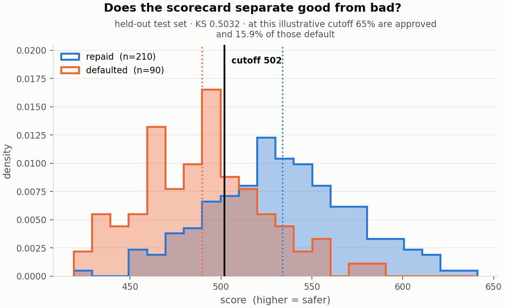
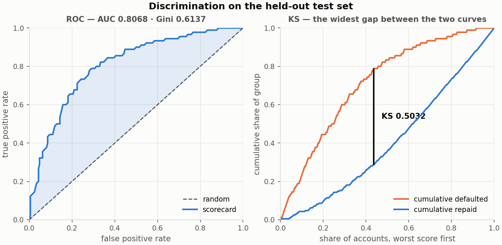
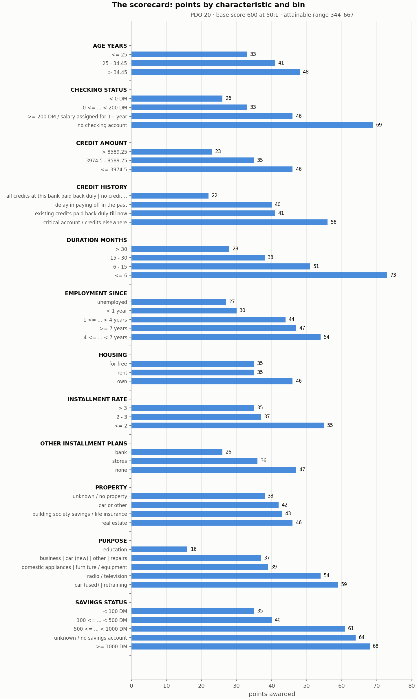
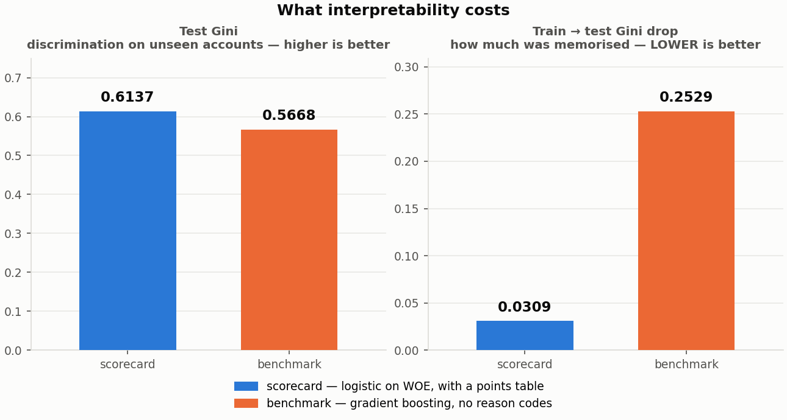
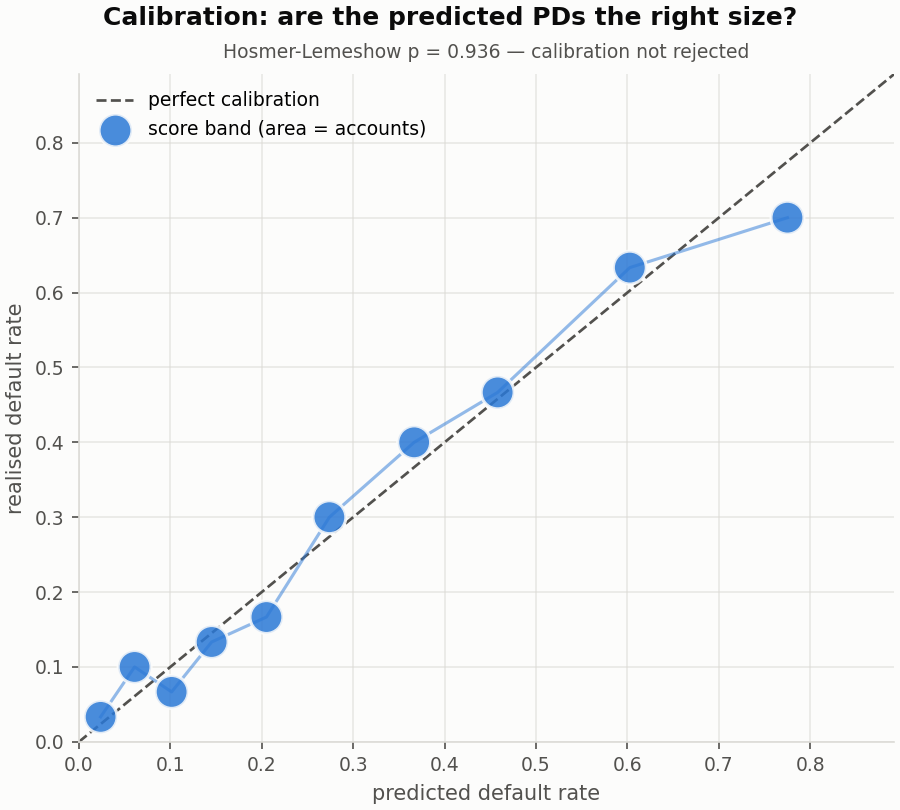

# 💳 Credit Default Scorecard

**An interpretable probability-of-default scorecard, built the way a bank builds one: WOE/IV feature engineering, a logistic PD model, full validation (KS / Gini / PSI / Hosmer-Lemeshow), PDO score scaling to a points table, an applicant scorer with reason codes — then benchmarked against gradient boosting to price the interpretability honestly.**


---

## The headline result

A scorecard is judged on three things: does it rank, is it stable, and can you
explain it to the person you declined. Every threshold below was set in
`config.yaml` **before** the model was fitted.

| Gate | Result | Threshold | |
|---|---|---|---|
| Gini (test) | **0.6137** | ≥ 0.30 | ✅ |
| Gini drop, train → test | **0.0309** | ≤ 0.15 | ✅ |
| PSI, train vs test | **0.0267** | ≤ 0.25 | ✅ |
| Hosmer-Lemeshow | p = **0.936** | not rejected at 5% | ✅ |

Supporting figures: **AUC 0.8068**, **KS 0.5032**, on a held-out 300-account test
set (700 train / 300 test, 30% bad rate, 12 characteristics).

**The uncertainty matters as much as the point estimate.** On 300 accounts with
90 bads, the Hanley-McNeil standard error of the AUC is 0.030, so the Gini
carries roughly **±0.060** — an approximate 95% interval of **[0.50, 0.73]**.
That clears the 0.30 floor across its whole range, which is the claim worth
making. It is also wide enough that small differences between models on this
dataset mean nothing, a point the benchmark section below depends on.




### The scorecard itself

The artefact that makes the whole approach defensible: an applicant can be shown
exactly which attribute cost them how many points, and the arithmetic is
addition.



Scaled with **PDO 20, base score 600 at 50:1 odds** — every 20 points halves the
odds of default, and 600 points means a 1.96% PD. The attainable range is
**344–667**. `base_odds` is the lever that moves that range, not `base_score`:
raising the base score shifts the offset and the whole range moves with it,
leaving the span invariant. Measured identical at 600, 520 and 500.

At an illustrative cutoff of **502**, 65% of applicants are approved and **15.9%**
of those approved default — against a 30% base rate. Where the cutoff actually
belongs is a business decision, not a modelling one, and
`scaling.cutoff_table` prints the whole frontier.

### What interpretability costs — on this data, nothing



| | Scorecard | Gradient boosting |
|---|---|---|
| Test Gini | **0.6137** | 0.5668 |
| Train Gini | 0.6445 | 0.8198 |
| Train → test drop | **0.0309** | **0.2529** |
| Reason codes | yes | no |

The gradient booster does **not** beat the scorecard here — it comes in 0.0468
Gini lower — and it memorises far more of its training set, dropping 0.2529 from
train to test against the scorecard's 0.0309.

**The right way to state that is carefully.** A 0.0468 difference is smaller
than the ±0.060 standard error on either estimate, so the honest claim is *no
evidence the benchmark is better on this dataset*, not *the scorecard is
better*. Settling it would need a paired DeLong test or repeated splits, and on
1,000 rows the answer would probably stay "too close to call".

The generalisation gap is the more robust signal: **0.2529 versus 0.0309** is an
eightfold difference and is exactly what you would expect from a flexible model
on 700 training rows. The conclusion that survives both readings is the useful
one — the interpretable model gives up nothing measurable here, and it is the
one that can be defended to a regulator and explained to a customer.

### Calibration



Ranking is not enough. A card can order applicants perfectly and still predict
the wrong *level*, which matters the moment the PD is used for pricing or
provisioning rather than only for accept/decline. Hosmer-Lemeshow does not
reject calibration (p = 0.936).

---

## Fair lending: the finding this project is proudest of

The raw German Credit data contains `personal_status_sex`, which encodes **sex**.
It is loaded, because the data should stay faithful to its source. What happens
next was decided in two stages, and the first one was not good enough.

**Stage one — the symptom.** The applicant scorer produced this reason code on a
declined application:

> *"you are in 'female: divorced / separated / married', which costs 18 points"*

That is an adverse-action notice citing a protected characteristic. A guard was
added: `reason_codes` raises `FairLendingError` rather than disclosing one.

**Stage two — the actual fix.** The guard suppressed the *disclosure*. The
attribute was still in the model, still moving the score, still declining
people. It was removed from `schema.categorical_columns` entirely, and the guard
stays in place as a second line of defence.

The lesson is the one worth taking to an interview: **suppressing a disclosure
is not the same as removing a variable.** The first makes the notice compliant;
only the second makes the decision compliant.

### What it cost

A measurement, not an opinion. `scripts/measure_fair_lending_cost.py` fits the
whole pipeline twice — with the characteristic and without, everything else held
fixed — and writes `docs/charts/fair_lending.json`, which `tests/test_docs.py`
then checks this README against.

| | With `personal_status_sex` | Without (shipped) |
|---|---|---|
| Test Gini | 0.6151 | **0.6137** |
| Test AUC | 0.8076 | **0.8068** |
| Test KS | 0.5270 | **0.5032** |

*(rounded to four places; the Gini cost at full precision is 0.0015)*

**Removing sex from the model costs 0.0015 Gini.** Against the ±0.060 standard
error on that estimate, the cost is **one fortieth of a standard error** — not
small, but indistinguishable from zero. Its standalone Information Value was
0.0392, inside the "weak" band and above the 0.02 selection floor, so it was
genuinely in the model and genuinely doing almost nothing.

**One honest wrinkle.** KS fell by 0.0238 — sixteen times the Gini movement.
The two statistics are not measuring the same thing: KS is the single widest gap
between the good and bad cumulative distributions, while Gini integrates across
the whole range. A characteristic can sharpen separation at one point on the
score scale without improving the overall ranking. Both figures are reported
here because quoting only the Gini would be choosing the metric that flatters
the decision.

## The method

```
load → bin → WOE/IV → logistic PD → validate → scale → score → benchmark
```

1. **Load & target** — decode the A-codes to plain English at load time, define
   good/bad, split train/test with a fingerprinted manifest.
2. **Binning** — fine then coarse classing into monotonic risk bins, with a
   minimum bin size so no bin is 1% of the book.
3. **WOE / IV** — `WOE = ln(%good / %bad)`; positive means safer. IV selects
   features; suspiciously high IV (≥ 0.50) is **flagged for a human, never
   auto-dropped** — that is the signature of leakage.
4. **PD model** — logistic regression on WOE, with an events-per-variable guard
   (minimum 10), VIF, and a perfect-separation check.
5. **Validation** — KS, Gini/AUC, Hosmer-Lemeshow, PSI, rank ordering, each
   against a threshold set in config before the model was fitted.
6. **Scaling** — `Factor = PDO / ln2`, `Offset = BaseScore − Factor·ln(BaseOdds)`,
   verified against the model's own PD within a tolerance of 0.5 points *per
   characteristic* — rounding error scales with the number of characteristics,
   so a flat tolerance is wrong.
7. **Scorer** — PD, score, decision and reason codes for any applicant, with the
   fair-lending guard.
8. **Benchmark** — gradient boosting, to price the interpretability.

Full derivations in [`docs/methodology.md`](docs/methodology.md).

## Try it

```bash
git clone https://github.com/esiihle/credit-default-scorecard.git
cd credit-default-scorecard
python -m venv .venv && source .venv/bin/activate
pip install -r requirements.txt

pytest                                   # the full suite
python app/scorer.py --examples          # score three worked applicants
python app/scorer.py --table             # print the points table
python app/scorer.py                     # interactive: score your own
python app/scorer.py --batch applicants.csv --cutoff 580
```

For the real numbers, download
[`german.data`](https://archive.ics.uci.edu/ml/machine-learning-databases/statlog/german/german.data)
into `data/raw/`, then:

```bash
python scripts/run_pipeline.py                  # the full pipeline
python scripts/make_charts.py                   # regenerates every chart above
python scripts/measure_fair_lending_cost.py     # measures the cost of the removal
pytest tests/test_docs.py                       # checks this README against both
```

`docs/charts/numbers.json` records the figures the charts were built from, and
`tests/test_docs.py` checks the tables above against it. **A stale number in
this README fails the test suite** — which is not a hypothetical: it is how the
numbers in this file were found to be wrong on 22 October 2026, and the story is
in [`PROGRESS.md`](PROGRESS.md).

## Bugs this project found, and what each one taught

Every one was invisible in the output. Each is now pinned by a regression test
whose docstring tells the story.

| Bug | Symptom | Fix |
|---|---|---|
| **A test that enforced the wrong number** | `test_docs.py` hardcoded the very figures it was meant to verify, so the suite stayed green while the README reported a model that failed two gates it actually passed | Every documented figure is now checked **against `numbers.json`**, never against a literal in the test |
| **Singular matrix on a small sample** | 14 features, 5 bads: coefficients of −21.9, NaN standard errors, VIF of 299 — and on other library versions, a crash | Events-per-variable guard, `LinAlgError` translation, and a separation check on the standard error (separation gives *huge* SEs, not NaNs — statsmodels returned coefficient −13.4 with SE 16,342) |
| **Flat verification tolerance** | A correct 11-characteristic card failed a 1.0-point check at 2.277 | Rounding error is bounded by 0.5 points **per characteristic**; tolerance now scales |
| **`base_score` treated as the lever** | Raising it to widen the attainable range did nothing — the span was identical at 600, 520 and 500 | It shifts the offset, so the whole range moves. `base_odds` is the lever |
| **Sex in a reason code** | An adverse-action notice citing a protected characteristic | Guard, then removal from the model, with the cost measured by a script rather than asserted |
| **Bundled sample swallowed by `.gitignore`** | `data/*` ignored the committed sample; a fresh clone crashed and 2 of 4 tests failed | Ignore `data/raw/*` and `data/processed/*` only |

## Why this project

It is a South African bank credit-risk role in miniature:

| This repo | The real-world task |
|---|---|
| WOE/IV binning | Standard scorecard feature engineering |
| Logistic PD + points table | The model form regulators expect |
| KS / Gini / PSI against pre-set thresholds | Model validation and monitoring |
| Reason codes | Adverse-action notices (NCA; ECOA/Reg B abroad) |
| Removing a protected characteristic and pricing it | Fair-lending review |
| Benchmark vs GBM, with the uncertainty stated | The interpretability conversation, with numbers |

## Repository structure

```
src/            load, binning, woe, model, validate, scaling, scorecard, benchmark
app/scorer.py   interactive applicant scorer with reason codes
tests/          the fragile numerics, the hand-computed WOE/IV anchors, every bug above
scripts/        run_pipeline.py · make_charts.py · measure_fair_lending_cost.py
docs/           methodology.md · OVERVIEW.md · ROADMAP.md · charts/
.github/        CI: the full suite on Python 3.11 and 3.12
```

## Dataset

**German Credit** (UCI, 1,000 rows). Clean, documented, runs in seconds — the
right choice for getting the methodology exactly right. Its size is also the
binding constraint on every result above, which is why the standard errors are
quoted rather than hidden. **Lending Club is deliberately avoided**: its public
versions carry well-known target leakage, and recognising that is the more
mature move than scoring on it.

## Author

**Sihle Myeza** — BSc Computer Science (Wits), data analyst targeting
quantitative and credit-risk roles. Built in the open, one commit at a time.

## License

MIT — see [`LICENSE`](LICENSE).
