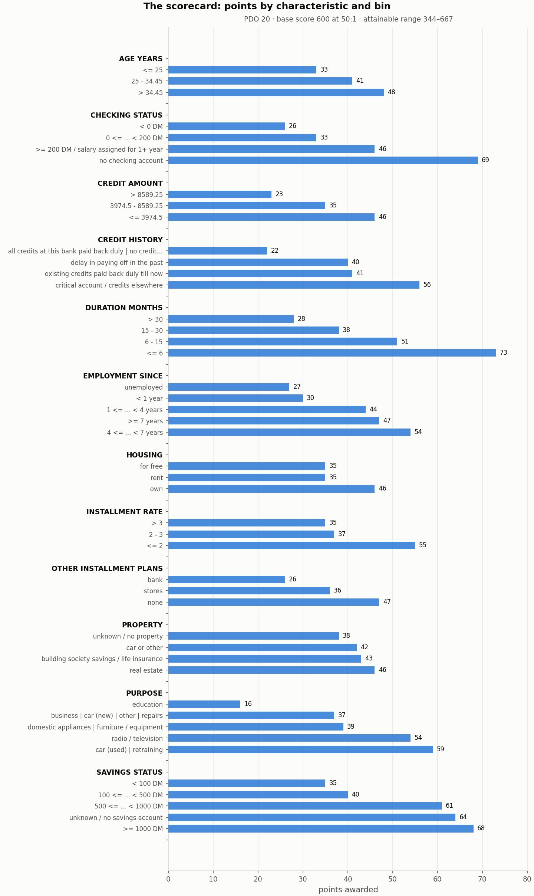
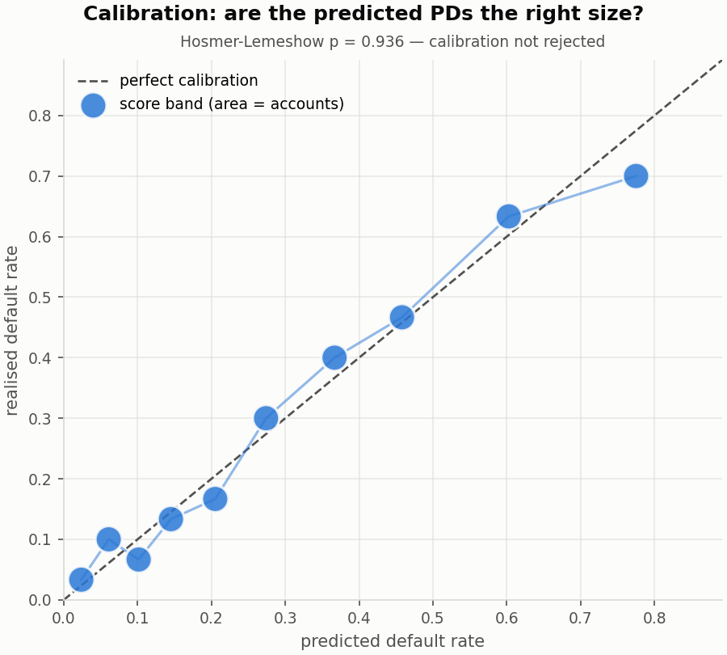

# 💳 Credit Default Scorecard
A probability-of-default scorecard built the way a bank builds one: WOE/IV binning, a logistic PD model, validation (KS, Gini, PSI, Hosmer-Lemeshow), PDO scaling to a points table, and an applicant scorer with reason codes. I also benchmarked it against gradient boosting to measure what staying interpretable actually costs.


## Results

A scorecard has to rank applicants well, stay stable on new data, and be explainable to the person you decline. I set every threshold in `config.yaml` before fitting the model.

| Gate | Result | Threshold | Pass |
|---|---|---|---|
| Gini (test) | 0.6137 | ≥ 0.30 | ✅ |
| Gini drop, train → test | 0.0309 | ≤ 0.15 | ✅ |
| PSI, train vs test | 0.0267 | ≤ 0.25 | ✅ |
| Hosmer-Lemeshow | p = 0.936 | not rejected at 5% | ✅ |

Test AUC is 0.8068 and KS is 0.5032, on a held-out set of 300 accounts (700 train, 300 test, 30% bad rate, 12 characteristics).

With only 90 bads in the test set, the Gini has a standard error of about ±0.060, which gives a rough 95% interval of [0.50, 0.73]. The whole interval clears the 0.30 floor. It's also wide enough that small differences between models on this dataset don't mean much, which matters for the benchmark below.


## The points table

This is what makes a scorecard easy to defend: an applicant can see exactly which attribute cost them how many points, and the score is just their sum.



It's scaled with PDO 20 and a base score of 600 at 50:1 odds. Every 20 points halves the odds of default, and 600 points means a 1.96% PD. Scores range from 344 to 667.

To change that range you adjust `base_odds`, not `base_score`. Raising the base score shifts the whole range up without widening it; I checked at 600, 520 and 500 and the span was identical each time.

At an example cutoff of 502, 65% of applicants are approved and 15.9% of those default, against a 30% base rate. Choosing the real cutoff is a business decision, so `scaling.cutoff_table` prints the full trade-off.

## Scorecard vs gradient boosting


| | Scorecard | Gradient boosting |
|---|---|---|
| Test Gini | 0.6137 | 0.5668 |
| Train Gini | 0.6445 | 0.8198 |
| Train to test drop | 0.0309 | 0.2529 |
| Reason codes | yes | no |

Gradient boosting doesn't beat the scorecard here. Its test Gini is 0.0468 lower, but that gap is smaller than the ±0.060 standard error, so the fair conclusion is that there's no evidence the benchmark is better, not that the scorecard is better.

The clearer difference is overfitting. Gradient boosting drops 0.2529 from train to test, about eight times the scorecard's 0.0309, which is what you'd expect from a flexible model on 700 rows. On this data the interpretable model gives up nothing measurable, and it's the one you can explain to a regulator and a customer.

## Calibration



Ranking isn't enough on its own. A model can order applicants correctly and still predict the wrong level of risk, which matters as soon as the PD is used for pricing or provisioning. Hosmer-Lemeshow does not reject calibration (p = 0.936).

## Fair lending: removing sex from the model

The German Credit data has a column, `personal_status_sex`, that encodes sex. I fixed this in two steps, and the first wasn't enough.

**Step one.** The scorer gave this reason code on a declined application:

> *"you are in 'female: divorced / separated / married', which costs 18 points"*

That's an adverse action notice citing a protected characteristic. I added a guard so `reason_codes` raises a `FairLendingError` instead of showing it.

**Step two.** The guard only hid the reason. The attribute was still in the model, still changing scores and still declining people. So I removed it from `schema.categorical_columns`, and kept the guard as a backup.

Suppressing a disclosure is not the same as removing a variable. The first makes the notice compliant; only the second makes the decision compliant.

### What it cost

`scripts/measure_fair_lending_cost.py` fits the pipeline twice, with and without the column, and writes the results to `docs/charts/fair_lending.json`. The tests check this README against that file.

| | With `personal_status_sex` | Without (shipped) |
|---|---|---|
| Test Gini | 0.6151 | 0.6137 |
| Test AUC | 0.8076 | 0.8068 |
| Test KS | 0.5270 | 0.5032 |

Removing it cost 0.0015 Gini, about one fortieth of the standard error. Its Information Value was 0.0392: high enough to be selected, but doing very little.

KS fell more, by 0.0238. KS measures the single biggest gap between the good and bad score distributions, while Gini covers the whole range, so a variable can sharpen separation at one point without improving overall ranking. I report both rather than only the one that looks better.

## Method

```
load → bin → WOE/IV → logistic PD → validate → scale → score → benchmark
```

1. **Load.** Decode the dataset's codes into plain English, define good and bad, and split train and test with a fingerprinted manifest.
2. **Binning.** Fine then coarse classing into monotonic risk bins, with a minimum bin size.
3. **WOE and IV.** `WOE = ln(%good / %bad)`, where positive means safer. IV is used to select features. A very high IV (≥ 0.50) is flagged for review rather than dropped automatically, since it usually points to leakage.
4. **PD model.** Logistic regression on WOE values, with checks for events per variable (at least 10), VIF and perfect separation.
5. **Validation.** KS, Gini, AUC, Hosmer-Lemeshow, PSI and rank ordering, each against a threshold set before fitting.
6. **Scaling.** `Factor = PDO / ln2`, `Offset = BaseScore - Factor·ln(BaseOdds)`, checked against the model's own PD within 0.5 points per characteristic. Rounding error grows with the number of characteristics, so a flat tolerance would be wrong.
7. **Scorer.** PD, score, decision and reason codes for any applicant, with the fair lending guard.
8. **Benchmark.** Gradient boosting, to measure the cost of interpretability.

Full derivations are in [`docs/methodology.md`](docs/methodology.md).

## Run it

```bash
git clone https://github.com/esiihle/credit-default-scorecard.git
cd credit-default-scorecard
python -m venv .venv && source .venv/bin/activate
pip install -r requirements.txt

pytest                                   # the full suite
python app/scorer.py --examples          # score three example applicants
python app/scorer.py --table             # print the points table
python app/scorer.py                     # score your own applicant interactively
python app/scorer.py --batch applicants.csv --cutoff 580
```

For the full results, download [`german.data`](https://archive.ics.uci.edu/ml/machine-learning-databases/statlog/german/german.data) into `data/raw/`, then:

```bash
python scripts/run_pipeline.py                  # the full pipeline
python scripts/make_charts.py                   # regenerates every chart
python scripts/measure_fair_lending_cost.py     # measures the cost of removing sex
pytest tests/test_docs.py                       # checks this README against both
```

`docs/charts/numbers.json` stores the figures behind the charts, and `tests/test_docs.py` checks the tables in this README against it, so an out-of-date number fails the tests. I added this after finding wrong numbers in this README on 22 October 2026; [`PROGRESS.md`](PROGRESS.md) has the details.

## Bugs I found along the way

None of these showed up in the output. Each now has a regression test.

| Bug | What happened | Fix |
|---|---|---|
| A test that enforced the wrong number | `test_docs.py` hardcoded the figures it was meant to check, so tests passed while the README reported a model failing two gates it actually passed | Figures are now checked against `numbers.json`, never against values typed into the test |
| Singular matrix on a small sample | 14 features and 5 bads gave a coefficient of -21.9, NaN standard errors and a VIF of 299 | Events-per-variable guard, clearer error handling, and a separation check on standard errors |
| Flat verification tolerance | A correct 11-characteristic card failed a 1.0-point check at 2.277 | Tolerance now scales at 0.5 points per characteristic |
| `base_score` treated as the range setting | Raising it didn't widen the score range | `base_odds` controls the range; `base_score` only shifts it |
| Sex in a reason code | An adverse action notice cited a protected characteristic | Guard, then removal from the model, with the cost measured |
| Sample data ignored by `.gitignore` | `data/*` excluded the committed sample, so a fresh clone crashed | Ignore only `data/raw/*` and `data/processed/*` |

## How it maps to a bank credit risk role

| This repo | In a bank |
|---|---|
| WOE/IV binning | Standard scorecard feature engineering |
| Logistic PD and points table | The model form regulators expect |
| KS, Gini and PSI against preset thresholds | Model validation and monitoring |
| Reason codes | Adverse action notices under the NCA |
| Removing a protected characteristic and measuring the cost | Fair lending review |
| Benchmark against gradient boosting | The interpretability discussion, with numbers |

This project produces a PD. My [credit risk ECL engine](https://github.com/esiihle/credit-risk-ecl-engine) takes a PD and turns it into an IFRS 9 provision.

## Repository layout

```
src/            load, binning, woe, model, validate, scaling, scorecard, benchmark
app/scorer.py   interactive applicant scorer with reason codes
tests/          numerical edge cases, hand-computed WOE/IV checks, every bug above
scripts/        run_pipeline.py, make_charts.py, measure_fair_lending_cost.py
docs/           methodology, overview, roadmap and charts
.github/        CI on Python 3.11 and 3.12
```

## Dataset

German Credit from UCI: 1,000 rows, clean and well documented, and quick to run, which made it a good fit for getting the method right. Its small size limits every result above, which is why I quote standard errors.

I avoided Lending Club because its public versions have known target leakage.

## Author

Sihle Myeza. BSc Computer Science (Wits), data analyst at iqbusiness.

## License

MIT. See [`LICENSE`](LICENSE).
